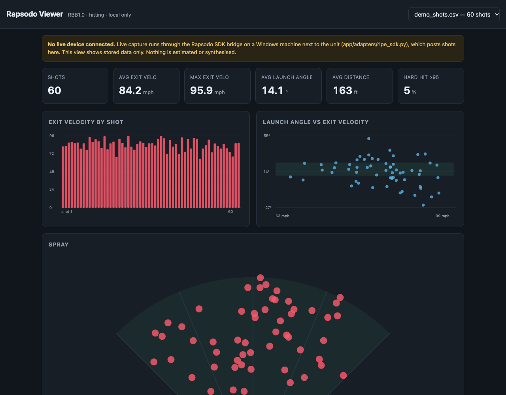

# Rapsodo RBB1.0 — local data viewer


*Screenshot uses a synthetic demo CSV, not real shot data.*

A self-hosted viewer for a Rapsodo Baseball **HITTING** 1.0 launch monitor.
Runs entirely on `127.0.0.1`. No Rapsodo account, no cloud, no subscription.
Your data lives in a local SQLite file you own.

## Status

| Piece | State |
|---|---|
| Storage + schema (SQLite) | ✅ working |
| Web UI (tiles, EV chart, LA×EV scatter, spray, shot table) | ✅ working |
| CSV import (fuzzy headers, junk-preamble tolerant) | ✅ working |
| Device discovery toolkit | ✅ working |
| **USB data link to the unit** | ✅ **FOUND — device enumerates, endpoints open** |
| Wire protocol over that link | ❌ undecoded — unit sends nothing unprompted |
| Live capture | ❌ blocked on the above |

### The USB breakthrough (2026-09-27)

Wi-Fi is a dead end (unit is silent, locked to a previous owner's network,
no reset button, reprovisioning paywalled). **USB works instead.**

```
VID:PID        0x4003:0x0002
strings        "RAPSODO" / "RAPSODO BB in HS" / serial 00000000001B
               "Default Config" / "Default Interface"
speed          USB 2.0 High-Speed (480 Mbps), 500 mA
interface 0    class 0xFF (vendor-specific), subclass 0, protocol 0, 1 alt setting
  EP 0x81      BULK IN   maxpacket 512
  EP 0x01      BULK OUT  maxpacket 512
kernel driver  none claims it - free for libusb
```

Verified: `GET_STATUS` returns `0000` for the device and both endpoints (healthy,
not stalled), `GET_CONFIGURATION` returns `01`. The device is live and listening.

**It sends nothing unsolicited.** 65 s on EP 0x81 produced 0 bytes. It must be
asked first, and the command vocabulary is unknown.

Important caveat: this earlier failed twice for reasons that had nothing to do
with the unit — a hub port with no data lines, and `system_profiler
SPUSBDataType` returning zero bytes so the detector could never have seen it.
Use `tools/usbcheck.sh` (ioreg-based) for this, never `system_profiler`.

### Probing safely

`tools/usbprobe.py` has read-only `info` and `listen`; `send` writes and prompts.
`tools/usbsweep.py` runs a bulk-OUT probe campaign.

**Do not send blind vendor CONTROL requests with bmRequestType 0x40
(host-to-device).** On EZ-USB-style parts - whose "Default Config"/"Default
Interface" strings this device shares - vendor request `0xA0` writes device RAM
and can overwrite firmware. Bulk-OUT writes are much safer: firmware that
doesn't recognise a payload normally ignores it.

### What has been ruled out (2026-09-27)

| Probe | Result |
|---|---|
| Unsolicited data, 75 s on EP 0x81 | 0 bytes |
| 20 bulk-OUT payloads (ASCII console, SCPI `*IDN?`, single-byte opcodes, length-prefixed frames, magic strings) | all writes accepted, 0 replies |
| 60 s listen while physically triggering the sensor | 0 bytes |
| **510 vendor control requests, IN direction** (`bmRequestType` 0xC0 and 0xC1, `bRequest` 0x00-0xFF, excluding 0xA0) | **all returned 64 bytes, but only ONE distinct payload** |

The vendor-request result is the decisive one. Every reply is:

```
<8-byte echo of the SETUP packet> 04 00 01 20 10 21 01 20 ac 1e 02 20
                                  a4 5a 01 20 24 28 01 20 00 00 ...
```

The payload is byte-identical for all 510 requests, so **no vendor request is
actually handled** - the firmware falls through to a generic path that echoes
the setup packet and returns a stale buffer. There is no vendor command
vocabulary to find.

Incidental finding: those trailing bytes are little-endian Cortex-M pointers -
`0x20010004 0x20012110 0x20021eac 0x20015aa4 0x20012824` - all in the
`0x20000000` SRAM region. So the USB host controller is an **ARM Cortex-M
(STM32-class) MCU**, which fits an STM32 driving the Inventek Wi-Fi module and
the Cyclone IV FPGA. The firmware leaks a little SRAM in these replies.

**Conclusion:** the command path must be a specific binary framing on BULK OUT
(EP 0x01). That framing cannot be derived by guessing - the space is unbounded
and the device gives no feedback signal (no stalls, no error replies, nothing
to hill-climb on). Decoding it requires a **reference client** to observe, and
none is publicly available: the 1.0-era apps talk over Wi-Fi, not USB.

### Brute-force campaign (2026-09-27)

Run at the owner's explicit request after I'd argued it was unlikely to work.

**4,295 distinct probes. Zero reproducible responses.**

| Phase | Space | Result |
|---|---|---|
| Vendor control IN (0xC0/0xC1, all bRequest except 0xA0) | 510 | one constant payload, no handler |
| Single-byte opcodes | 256 | silent |
| Two-byte + sync-word pairs (0x55/0xAA/0x7E/0xA5/0x5A/0xFF/...) | 2,814 | silent |
| Text commands × 8 terminators | 296 | silent |
| Structured frames (sync/cmd/len/checksum, LE32, BE32) | 672 | silent |

Method: every probe checked against four oracles — bulk IN reply, a device-state
oracle (the leaked SRAM buffer from the vendor request, verified stable at 40/40
identical samples), endpoint stall, and write-duration outliers.

**Three apparent "state changes" were all false positives**, each non-reproducible
at 0/5 on retest. The leaked buffer occasionally catches different stale RAM
(ARM Thumb-2-looking code bytes) when firmware activity coincides with the read.
Any future probing must retest a hit several times before believing it.

**Conclusion: the bulk-OUT command set is not reachable by guessing.** The device
gives no gradient — no stalls, no error replies, no timing signal — so there is
nothing to hill-climb on, and the framing space is unbounded. This needs a
reference client or the UART header, not more probing.

### The unit powers itself off every few minutes

Discovered mid-campaign: the unit switches off on an idle timer and must be
manually powered back on. `tools/usbbrute.py` detects this, waits, reconnects
and resumes (it survived 3 power cycles in one run), and records progress in
`findings/usbbrute-progress.json` so reruns skip tested payloads.

**This weakened the earlier Wi-Fi conclusions**, so they were retested.

### Wi-Fi retest with power confirmed (2026-09-27) — negative, and this one is valid

Earlier Wi-Fi negatives were suspect because the unit may have powered itself
off mid-scan. Retested with the unit's power state confirmed *simultaneously*
by USB enumeration:

| Check | Result |
|---|---|
| Unit powered? | **YES** — 1 Rapsodo device live on USB at scan time |
| Rapsodo SSID on the Mac | no; 1 × 2.4 GHz network in range, WPA2, unchanged |
| Rapsodo SSID on the phone | no (owner checked seconds after power-on) |
| Inventek MAC on the LAN | absent |

This is the first Wi-Fi negative with *positive proof the unit was on at that
moment*, so unlike the earlier ones it stands. **The Wi-Fi path is genuinely
closed**: the radio does not broadcast, does not join, and cannot be
reprovisioned without the paywalled app.

## ⭐ SOLVED: use Rapsodo's own SDK (PlatformLib.dll)

The USB bulk protocol never needed reversing. The free 1.0-era Windows app ships
**PlatformLib.dll — Rapsodo's device SDK**, a native x86 C API with 123 exports
all prefixed `RIPE*`. Installed at:

    C:\Rapsodo\RapsodoPitching\RapsodoPitching_Data\Plugins\PlatformLib.dll

### Why 4,295 blind probes found nothing

From the SDK's own `RIPEBoxStateType`:

    INIT -> WAIT_FOR_CONNECTION -> **WAIT_FOR_SYS_CONFIG** -> DISARMED
    -> ARMED -> TRIGGERED -> TRANSFER

The box sits in `WAIT_FOR_SYS_CONFIG` until the host pushes it the sysConfig
struct (read from `BB1Config.ini`), and even configured it will not trigger
until `RIPE_CMD_ARM`. An unconfigured, disarmed box **correctly ignores
everything**. The framing was never the problem; the device simply was not
listening yet. No amount of guessing could have worked.

### Hitting vs pitching: closed

`RIPEProductType { UNKNOWN=0, PITCHING=1, HITTING=2 }` — HITTING is a
first-class value in the *Pitching* build's own enum, and product type is a
runtime query against the box (`RIPEGetBoxStaticData`), not a build constant.
The config files contain no hitting/pitching distinction at all; baseball vs
softball differs by **two lines out of 8,189**.

### Subscription: not in our path

There IS a subscription system (`RCIActionSubscription`) but it is entirely in
the Unity **app** layer and gates Rapsodo's **cloud**: players allowed, video
upload, shot history past 50. There are **zero licence/activation checks in the
PlatformLib P/Invoke path** — `RIPEInit`, `RIPEDiscover`, `RIPEBoxConnect`,
`RIPEGetFlightData` are unconditional. Local device access was never gated.

**DESIGN RULE: never implement RipeUploader or any cloud endpoint.** Local
storage and local viewer only. It is the only area with any ambiguity and it
buys us nothing.

### The .rif escape hatch — why today mattered

`RIPEStartSaving` / `RIPEStopSaving` record a session to a `.rif` file, and
`RIPEFeedOfflineRifData(handle, path)` **replays it through the entire pipeline**.
A `.rif` captured while the hardware is available can be replayed forever — no
device, no battery. That converts a one-day hardware window into a permanent
development asset.

### Shot schema (now the storage schema)

`app/store.py` mirrors the real structs, replacing earlier invented field names:

| SDK struct | Fields |
|---|---|
| `RIPESpeedParamsType` | totalSpeed, launchAngle, horizontalAngle + a confidence for each, startBallPositionStatus |
| `RIPESpinParamsType` | totalSpin, backSpin, sideSpin, spinAxis, measurementConfidence |
| `RIPEFlightParamsType` | carry, side, maxHeight, flightDuration, validPointCount, pts[2010] |
| `FlightModelData` | vX/vY/vZ, pX/pY/pZ, sX/sY/sZ, x/y/z[4000], ballType, pitching |

Old guessed names map as: exit_velocity→total_speed, direction→horizontal_angle,
distance→carry, spin_rate→total_spin (CSV importer still accepts the old names).
`hit_type` has **no SDK equivalent** — it is derived locally from launch angle
and flagged as derived, not measured.

### Gotchas

- `RIPEEventType` **starts at 27**, not 0. An event switch assuming 0 breaks silently.
- PlatformLib.dll is **32-bit x86** — the host process must be 32-bit.
- Most entry points are Cdecl; the node-walking helpers are StdCall.
- The app never calls `RIPEGetBoxProductType` etc. individually — it uses
  `RIPEGetBoxStaticData` for all identity in one call. Do the same.

### Command safety

`RIPEBoxCmdType` is the real command vocabulary. **Permitted: ARM (15), DISARM
(16)** — normal operational state changes the app uses every session.
**Blocked: SHUTDOWNBOX, RESTART, UPGRADE_FIRMWARE, MODE_CALIBRATE, MODE_DEBUG,
BOOT_FORCE_*, SET_NWCONFIG, SET_USERPERSISTENTDATA** — these persist state,
touch firmware or reconfigure connectivity, all bricking/lockout risks on
irreplaceable hardware. If `RIPE_EVT_FW_UPGRADE_AVAILABLE` (37) appears,
**decline it**: a Pitching-build SDK pushing firmware to a hitting box is the
most dangerous action available.

## UNITS AND SIGN CONVENTIONS (read before touching the data)

Read out of the app's own conversion/UI layer, not inferred. **This database
stores SI**, because that is what the SDK emits; importers convert in, the UI
converts out.

| Quantity | SDK native | Convert for display |
|---|---|---|
| speed (`totalSpeed`) | **metres/second** | × 2.2369363 → mph, × 3.6 → km/h |
| distances (carry, side, maxHeight, release*, trajectory xyz) | **metres** | × 3.28084 → feet |
| spin (total/back/side/rifle) | **rpm already** | none — do NOT apply 9.549 |
| angles (launch, horizontal) | degrees | none |
| `flightDuration` | **UNKNOWN** | — |

Evidence: `speedText.text = (newSpeed * 2.2369363f)`, and
`baseballRadiusFeet = 0.036378f * metertoFeet` where 0.036378 m is the real
baseball radius. Rapsodo's own `Shot.speed` column stores raw m/s, not the
display value. Angles are strong inference (no multiplier found anywhere) rather
than proven. `flightDuration` is never rendered by the Pitching UI, so there is
no formatting code to read its unit off — seconds is likely but unverified.

### Sign traps

**1. Strike-zone origin is the GROUND, not the zone centre.** `(0,0)` is the
point on the ground at the middle of the plate, +Y up, in metres. Assuming a
centre origin puts every plotted ball ~0.75 m too high.

```
half_width       0.225 m          top        1.0668 m  (exactly 3.5 ft)
outer_half_width 0.45  m          outer_top  1.4    m
```
0.45 m half-width = 17.7 in full, i.e. the regulation 17" plate plus a ball.

**2. `strikeZoneX` is NEGATED** relative to the SDK: the app stores
`0 - strikePosition.z`. The video-overlay export then negates it *again*, back
to SDK orientation, and negates `horizontalBreak` too. **Three coordinate
conventions are in play** — SDK native, app-stored, export. Pick one, document
it, convert at the boundaries.

**3. The spin-axis clock display is the COMPLEMENT** of the SDK value:
`12:00 − spinClockTiltHour/Minute`. Rendering the raw hour/minute shows a tilt
mirrored about 12 o'clock.

**4. Two different things are called `spinAxis`.** The SDK's is a scalar in
degrees. The app has its own `spinAxis = Vector3(backSpin, sideSpin, rifleSpin)`.
Different quantities, same name.

**5. Pull vs oppo is NOT determinable from this build.** The Pitching UI frames
X as catcher's-view plate location, and there is no handedness flip anywhere in
the plot path. For a hitting unit it depends on box orientation relative to the
batter, which this app never has to decide. **Make it a user-configurable flip
rather than baking in a guess** — the spray chart's current pull-left assumption
is unverified.

## The hardware: this unit does not respond (2026-09-27, final)

Established with the SDK's own diagnostic log at debugLogLevel=6:

```
wrapCommUSBSend: Sent 24 bytes to box          <- handshake write SUCCEEDS
<ERR> RIPEUSBRecv: Error(-7)TIMEOUT while rx data
<ERR> RIPEUSBRecv: Error(-7)TIMEOUT while rx data   ... once per second, forever
COMMUSBT:TIMEOUT during normal mode
RIPE_INT_EVT_USB_THREAD_TERMINATED(55)         <- gives up, reconnect loop
```

**Rapsodo's own SDK, sending Rapsodo's own correct handshake, gets nothing back.**
Error -7 is `LIBUSB_ERROR_TIMEOUT` on the bulk IN read. This reproduces the
4,295-probe result using the reference implementation. The protocol was never
the problem.

`RIPE_EVT_BOX_CONNECTED(27)` fires on *send* success, not on any reply — which
is why an early smoke test looked like it connected. It never did.

### Two readings, genuinely undetermined

1. **No application firmware** — the box sits in a bootloader that brings up USB
   (same VID/PID, passes the SDK's descriptor check) and ignores every
   application command.
2. **A hardware fault in the USB transmit path** or an upstream subsystem.

Evidence against #1, worth stating: a bootloader whose job is to receive
firmware over USB should answer the host, and this one answers nothing to
anything. It is also **not** ST's ROM DFU bootloader (that enumerates as
`0x0483:0xDF11`); this is `0x4003:0x0002` with Rapsodo strings. We cannot
distinguish the two without a reply from the box, and the project does not
claim one.

### Readings that were WRONG and are retracted

- **"Battery 0% / NOT_CHARGING"** is the *absence of telemetry*, not a reading.
  The SDK prints its dynamic-data block on a timer whether or not a packet
  arrives, and none ever arrives. `roll/tilt = -1` are init sentinels from the
  same never-populated block. The underpowered theory is dead; charging the unit
  and moving it to a rear USB 3.0 port changed nothing, exactly as this predicts.
- **"WAIT_FOR_SYS_CONFIG"** was predicted; the box reports `INIT`, one state earlier.
- **`boxSSID = 'NOWIFINONAME'`** — a sentinel for *no Wi-Fi configured*. The unit
  was never locked to a previous owner's network as assumed; it has no network
  at all. That explains the Wi-Fi silence, and it was never recoverable from the
  host side anyway, because the box answers nothing.

### Why firmware repair is out of reach

Never attempted, nothing written to the box. The vendor app reaches only a
**cloud login screen** and a current Rapsodo account does not authenticate
against this 2018 build, so it never gets to device discovery. And the SDK's
upgrade path needs an established session: `RIPESendBoxCommand` requires one,
the SDK tears down the USB thread after ~7 s of timeouts, and the upgrade gates
on a box firmware version that reads `-1.0`. Entering ST's ROM DFU would need
the BOOT0 pin, i.e. opening the case.

## What survives, and it is most of it

Everything below is device-independent and permanent:

- the complete RIPE API: signatures, calling conventions, struct layouts, enums
- the real shot schema, now mirrored in `app/store.py`
- the command vocabulary, event model and box state machine
- `RIPEFeedOfflineRifData` — a `.rif` from **any** working RBB1.0 replays through
  the whole pipeline, so the viewer can be finished and tested the day one exists
- a working local viewer

No `.rif` sample ships with the app (`RiffFolder` is empty), so that path needs a
recording from a functioning unit.

### One thing this viewer does that Rapsodo's own app does not

Rapsodo's `Shot` table does **not** persist the 4000-point flight path — it lives
in memory for the live plot and is discarded. This schema stores it. It also
carries per-shot provenance (serial, FW, HW version) so recordings are
self-describing, and `store.suspect()` flags shots where the image pipeline and
firmware disagree on ball count.

## Run it

```bash
python3 app/server.py                      # http://127.0.0.1:8777
python3 app/server.py --import shots.csv   # import a CSV first
```

Only Python 3 stdlib is required.

## What we know about the hardware

Established from the unit's label and its public FCC filing (FCC ID `2AH3O-RBB10`,
certified 2016-06-07):

- **Mode: HITTING only.** Label banner reads `BASEBALL HITTING`; serial prefix
  `RBH10`. Rapsodo charges a $1,000 activation to convert a single-mode unit to
  hitting+pitching. This project will not unlock a mode the unit isn't licensed
  for — that's a paid feature, distinct from reading your own data.
- **Wi-Fi radio:** Inventek ISM43362 (`FCC ID O7P-362`), 2.4 GHz 802.11 b/g/n only.
  AT-command driven, supports both client and SoftAP mode.
- **Wi-Fi MAC:** `<redacted>` (printed on the unit's label).
  `C4:7F:51` is Inventek's OUI. This is the fingerprint to hunt for on any network.
- **Processing:** Altera Cyclone IV FPGA + image sensor (camera) + radar.
- **Ports/controls:** one micro-USB (`5V 1.0A`), one power button. No reset button.
  The FCC exhibit list includes a separate *Schematics (USB)* document, so USB is a
  real subsystem, not necessarily charge-only.
- **Internal photos** show a 6-pin header on the main board — very likely a UART
  debug port. Reaching it means opening the case, past a tamper-evident label.

## Discovery workflow

Once the unit is reachable on a network:

```bash
python3 tools/discover.py                 # auto-detect, sweep, probe, listen
python3 tools/discover.py --host 192.168.1.1 --all-ports
python3 tools/discover.py --listen-only   # just watch for UDP broadcasts
```

It assumes nothing about the protocol: ping sweep → port scan → HTTP endpoint
probing → unsolicited-banner capture → UDP broadcast listen → SSDP. Results land
in `findings/*.json`. It flags any host with the Inventek OUI.

## Open blockers

Status as of 2026-09-27, unit charged and showing two solid red LEDs:

| Probe | Result |
|---|---|
| USB enumeration on macOS | nothing |
| New serial (tty/cu) device | nothing |
| Present on LAN (Inventek OUI) | absent, 55 hosts swept |
| Broadcasting a visible AP | none; only one 2.4GHz net in range and it's WPA2 |
| 802.11 monitor capture | **test invalid** - see below |

**The RF test could not be performed on this Mac.** `tcpdump -I` opened monitor
mode but delivered 0 packets and 0 beacons in 45 s, and the interface stayed
associated on 5 GHz channel 36 while the Rapsodo radio is 2.4 GHz-only. Both
facts independently invalidate it. `tools/rfscan.sh` now detects this and
refuses to report a result rather than printing a false negative. Sniffing this
properly needs a USB Wi-Fi adapter in monitor mode on Linux, or an ESP32.

**Still unresolved:** whether the unit is actually *booted* or merely *charging*.
Solid red on a charging device means nothing. Until it is confirmed to stay
powered on battery alone, every negative above is suspect.

Remaining paths, cheapest first:
1. Confirm it stays on unplugged; leave it powered 5-10 min and re-check Wi-Fi.
2. Re-test USB with a known-good *data* cable while confirmed powered.
3. Sniff 2.4 GHz with proper monitor-mode hardware.
4. The 6-pin UART header - requires opening the case past a tamper-evident label.

## Notes / gotchas discovered

- macOS writes the literal string `<redacted>` for every Wi-Fi SSID to processes
  without Location Services permission. Any SSID-name matching done from a script
  is structurally incapable of matching — don't trust a negative from it.
- `arp` returns **empty output with exit code 0** when spawned from Python in this
  sandbox, while working fine from a shell. `tools/discover.py` detects this and
  warns loudly rather than silently reporting zero hosts.
- `curl` to `127.0.0.1` is blocked from the sandboxed shell; Python can reach it.

## Layout

```
app/server.py          local HTTP server + CSV import CLI
app/store.py           SQLite schema and accessors
app/static/index.html  the whole UI (no build step, no dependencies)
app/adapters/          base.py · csvfile.py · rapsodo_live.py (stub)
tools/discover.py      network discovery for the unit
findings/              discovery output
data/rapsodo.db        your database (created on first use)
```
